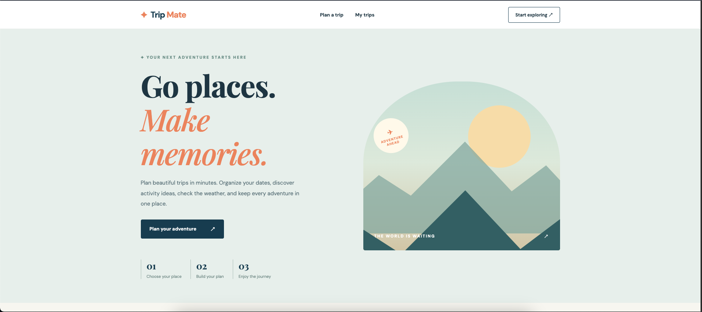
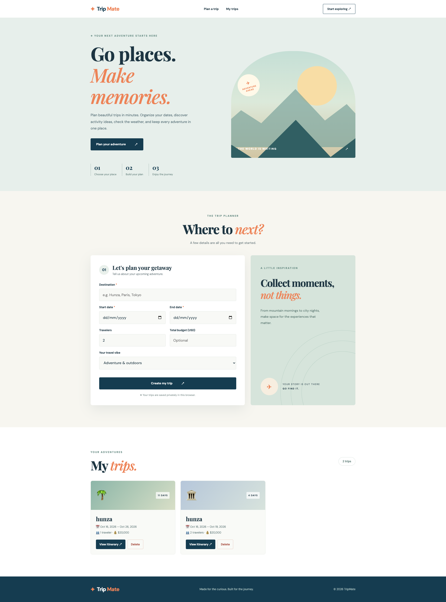

# TripMate – Smart Trip Planner

**Plan smarter. Travel better. Explore more.**

TripMate is a responsive travel planning web application developed using **HTML5, CSS3, and JavaScript (ES6+)**. It helps users plan trips, explore destination-based activities, check weather information, and organize travel itineraries in one convenient place.

The project demonstrates practical frontend development skills, including DOM manipulation, API integration, date handling, and LocalStorage.

## Project Screenshots

### Home Page & Travel Planner



### Trip Planning & Features



## Key Features

- **Trip Planning:** Create trips by entering your destination, travel dates, number of travelers, and budget.
- **Smart Activity Suggestions:** Generate travel activities automatically based on the selected destination and trip duration.
- **Weather Integration:** Fetch destination weather information using the Open-Meteo API.
- **Trip Management:** View and delete saved travel plans.
- **LocalStorage:** Store trip details in the browser and access them after refreshing the page.
- **Download Itinerary:** Export your travel itinerary for future reference.
- **Responsive Design:** Enjoy a consistent experience across desktop, tablet, and mobile devices.

## Technologies Used

| Technology | Purpose |
|---|---|
| HTML5 | Website structure |
| CSS3 | Styling and responsive design |
| JavaScript (ES6+) | Application functionality |
| Fetch API | Fetching external data |
| Open-Meteo API | Destination weather information |
| LocalStorage | Saving and retrieving trip data |

## Project Structure

```text
TripMate/
├── index.html
├── style.css
├── script.js
├── screenshots/
│   ├── tripmate1.png
│   └── tripmate2.png
└── README.md
```

## Getting Started

**1. Clone the repository**

```bash
git clone https://github.com/fizza-yousaf/Trip-mate.git
```

**2. Open the project**

```bash
cd Trip-mate
```

Open the folder in Visual Studio Code.

**3. Run the application**

Open `index.html` using the Live Server extension or your web browser.

No npm installation, frameworks, or build tools are required.

## How TripMate Works

1. **Enter Trip Details:** Choose a destination, start date, end date, number of travelers, and budget.
2. **Generate an Itinerary:** TripMate creates daily activity suggestions based on your travel destination and duration.
3. **Check the Weather:** View available weather information for your destination.
4. **Save Your Trip:** Store travel plans locally in your browser.
5. **Manage Your Plans:** View or delete saved trips.
6. **Download Your Itinerary:** Export your generated travel plan.

## JavaScript Concepts Implemented

This project helped me strengthen my practical knowledge of:

- DOM manipulation and dynamic HTML rendering
- JavaScript functions, arrays, and objects
- Event listeners and form handling
- Date calculations and validation
- Fetch API and asynchronous JavaScript
- JSON parsing and serialization
- LocalStorage data persistence
- Error handling and conditional rendering

## Future Improvements

- Interactive maps and destination previews
- Personalized travel recommendations
- Trip editing and customization
- Travel expense tracking
- Additional destinations and activities

## About the Developer

**Fizza Yousaf**

Frontend Developer | HTML | CSS | JavaScript | React

I enjoy building responsive, interactive, and user-friendly web applications. TripMate is one of my JavaScript projects, created to practice real-world frontend development concepts and improve my problem-solving skills.

**Connect with me:**

- **GitHub:** https://github.com/fizza-yousaf
- **LinkedIn:** https://www.linkedin.com/in/fizza-yousaf-63b884362/
- **Portfolio:** https://fizza-yousaf.github.io/fizza-yousaf-portfolio/

---

Developed by **Fizza Yousaf** using HTML, CSS, and JavaScript.
